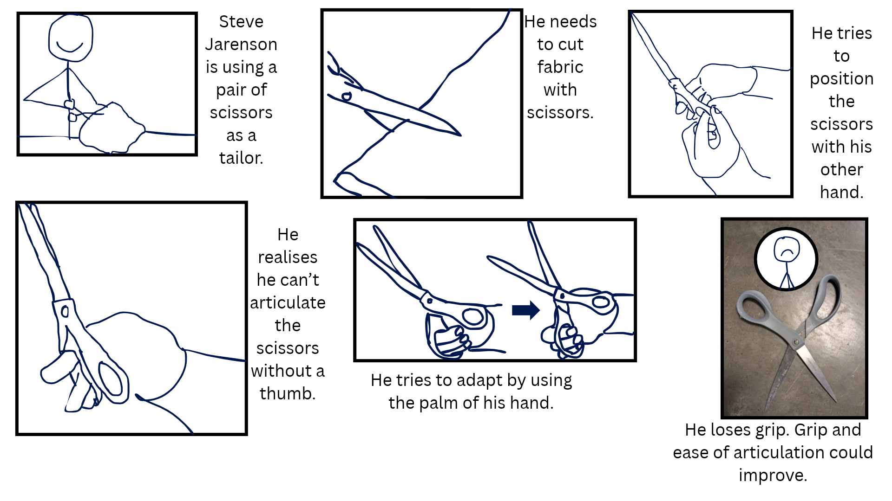
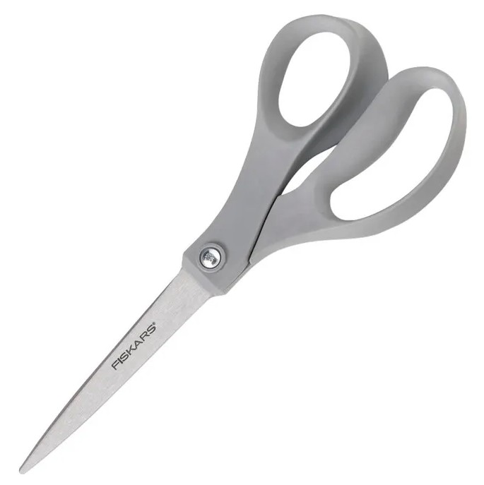
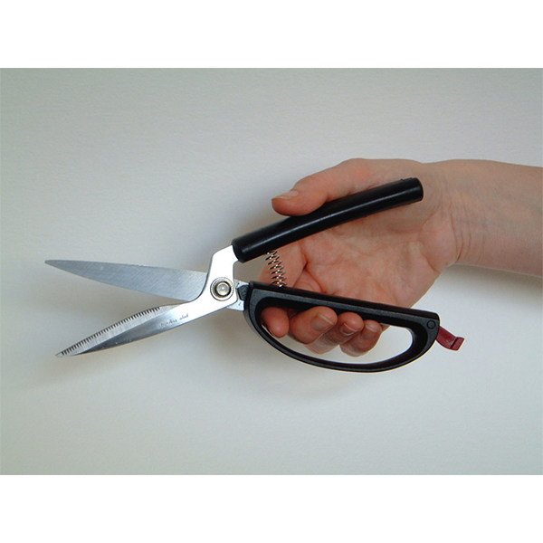
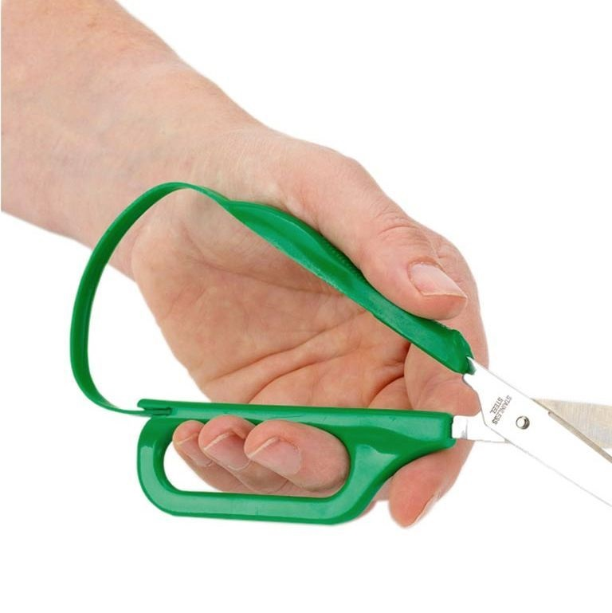

# Section A - Empathize
*Investigate the persona, storyboard the task, and analyze the original product and an existing adaptive solution.*  
  
---
# Persona
Steve Jarenson is a 24 year old male from Missouri. He works as a freelance tailor in Kansas. He is right hand dominant, and lost his thumb and index finger in a table saw accident at age 19, while building a birdhouse with his stepfather. He needs access to a reliable, easy to use, and convenient pair of scissors for his profession as a tailor, as he uses scissors regularly to cut fabric. Currently, he is using a standard pair of scissors from Office Depot, which is hard for him to articulate, and not stable in his hand. When cutting thicker materials, because of his lack of thumb, he has to use his other hand. This means he has no way to stabilize the material, and it takes longer and is significantly less convenient to make straight, accurate cuts. In his free time, he enjoys Bocce Ball, and he volunteers at his local rec center, helping with a kids Arts and Crafts program on Sundays, which also requires him to use a pair of scissors to cut paper.
  
# Storyboard

  
---
# Existing Product Analysis  
## Standard Commercial Scissors

- A standard pair of scissors is held with a hole for a thumb on one side, and a hole for digits two, three, and four on the other side.
- The blades are articulated by spreading apart the two holes, through the opening and closing of the palm, along with the slight lifting of digits two through four.
For an individual without a thumb and digit two, articulating the blades proves difficult, as the thumb is a major part in the use and stability of the scissors. The lack of a thumb means there is nothing to consistently articulate the top hole, which proves difficult to use the scissors.
  
---
# Existing Accessible Scissors  

## Existing Option 1:  
  
  
| Pros                                                              | Cons                                                  |
|-------------------------------------------------------------------|-------------------------------------------------------|
| Braces against palm without a thumb hole                          | Still uses thumb for additional stability             |
| Spring loaded to reopen without needing to be pulled open by a thumb | Top handle isn't ergonomic, it is just a straight bar. This can cause fatigue over time |
  
---
## Existing Option 2:  
  
  
| Pros                                                              | Cons                                                                                            |
|-------------------------------------------------------------------|-------------------------------------------------------------------------------------------------|
| The top bar is more ergonomic than option one, curving to the shape of the hand.             | Still uses the thumb for stability and strength for cutting.|
| Spring-loaded to reopen without needing to be pulled open by thumb | Uses digit two for additional stability, which is missing    |
|       | The plastic "spring" portion doesn't appear to be structurally sound, and has a high likelihood of fatuge |
|       | The bottom finger hole is not ergonomic, it's just a flat bar with an oval hole.|

